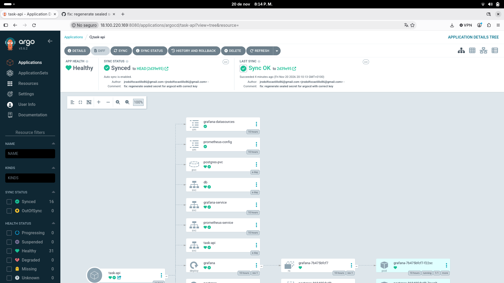
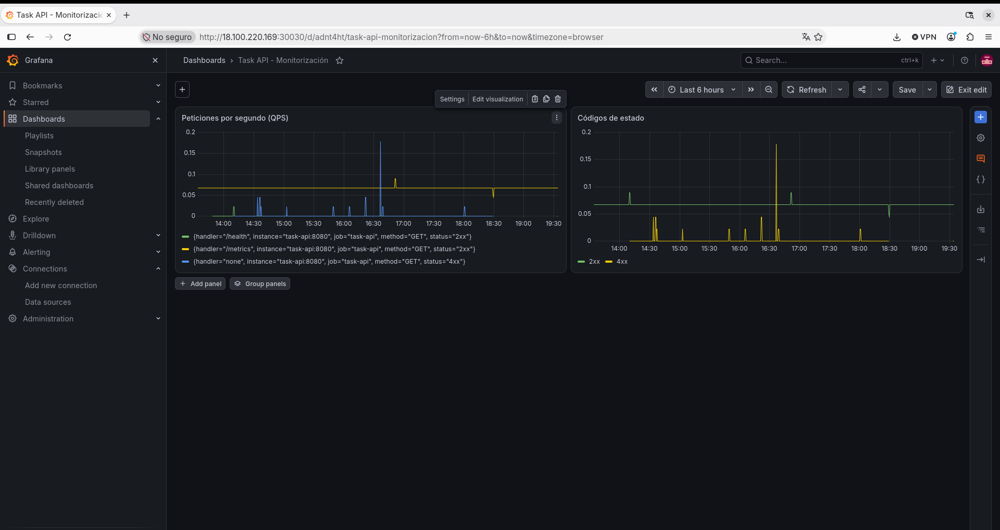
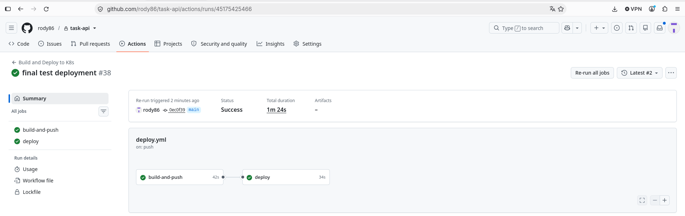

# 🚀 Task API - Proyecto de Infraestructura y Despliegue DevOps


Este repositorio contiene el ciclo de vida completo de una API REST (FastAPI + PostgreSQL), desde el código fuente hasta su despliegue automatizado en AWS usando las mejores prácticas de DevOps modernas y un enfoque *Zero-Touch*.

## 🏗️ Arquitectura del Proyecto

El flujo de trabajo está diseñado para ser 100% automatizado:

1. **Desarrollo:** Código en Python (FastAPI) containerizado con Docker (multi-stage, usuario no root).
2. **CI (Integración Continua):** GitHub Actions construye la imagen y la publica en GitHub Container Registry (GHCR).
3. **CD (Despliegue Continuo):** GitHub Actions se conecta por SSH a la instancia EC2 y aplica los manifiestos de Kubernetes.
4. **Infraestructura:** AWS aprovisionada con Terraform (VPC, EC2, Security Groups, discos gp3 de 20GB).
5. **Orquestación:** K3s (Kubernetes ligero) ejecutándose en la instancia EC2.
6. **GitOps:** ArgoCD monitoriza el repositorio y mantiene el clúster sincronizado con el estado deseado.
7. **Ingress:** Traefik expone la aplicación en el puerto 80.
8. **Seguridad:** Implementación de **Sealed Secrets** para cifrar las credenciales de la base de datos en el repositorio, cumpliendo con los estándares de GitOps seguro.
9. **Observabilidad:** Prometheus y Grafana para monitorizar métricas de tráfico y estado.

## 🛠️ Stack Tecnológico

*   **Lenguaje:** Python 3.12 / FastAPI
*   **Base de Datos:** PostgreSQL 16
*   **Contenedores:** Docker, Docker Compose
*   **IaC:** Terraform (Backend Remoto en S3 y DynamoDB)
*   **Cloud:** AWS (EC2, VPC, S3, IAM)
*   **Orquestación:** Kubernetes (K3s)
*   **CI/CD:** GitHub Actions
*   **GitOps:** ArgoCD
*   **Seguridad:** Bitnami Sealed Secrets, Kubernetes Secrets
*   **Ingress:** Traefik
*   **Observabilidad:** Prometheus, Grafana

## 📂 Estructura del Repositorio

*   `app/`: Código fuente de la API en FastAPI.
*   `k8s/`: Manifiestos de Kubernetes (`api.yaml`, `db.yaml`, `ingress.yaml`, `postgres-sealed-secret.yaml`).
*   `terraform/`: Código de Terraform para aprovisionar la infraestructura en AWS.
*   `.github/workflows/`: Pipelines de CI/CD.

## 🚀 Cómo desplegar este proyecto

1. **Aprovisionar infraestructura:**
   ```bash
   cd terraform
   terraform init
   terraform apply

## 📸 Capturas del Proyecto

### GitOps con ArgoCD
Aquí se muestra la aplicación sincronizada y saludable, gestionada automáticamente desde el repositorio.


### Observabilidad con Grafana
Dashboard mostrando las métricas de tráfico de la API, capturadas por Prometheus.


### Pipeline de CI/CD
GitHub Actions construyendo la imagen y desplegando automáticamente.

